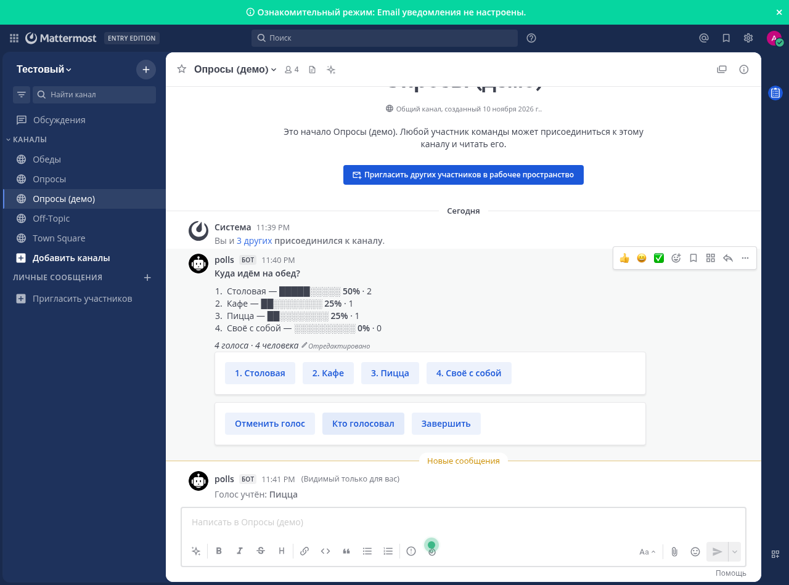
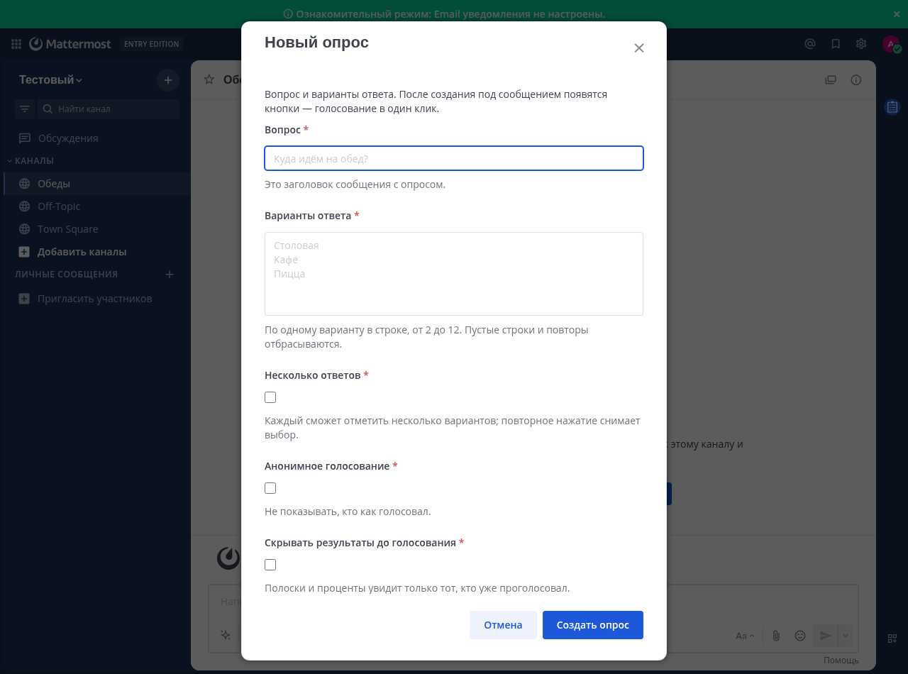
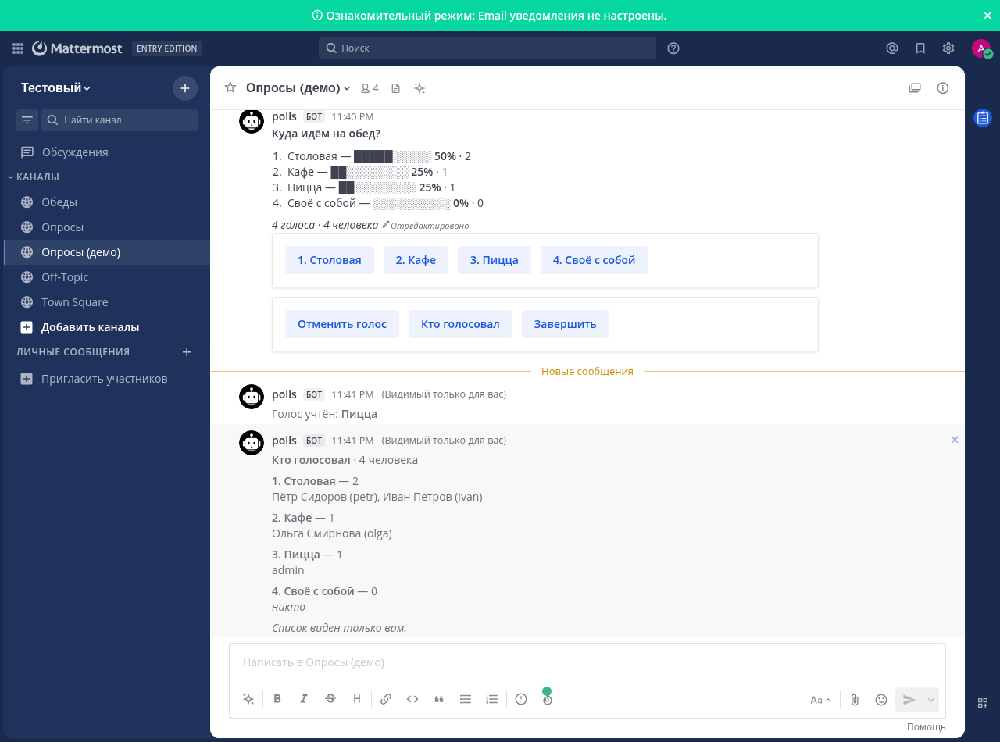
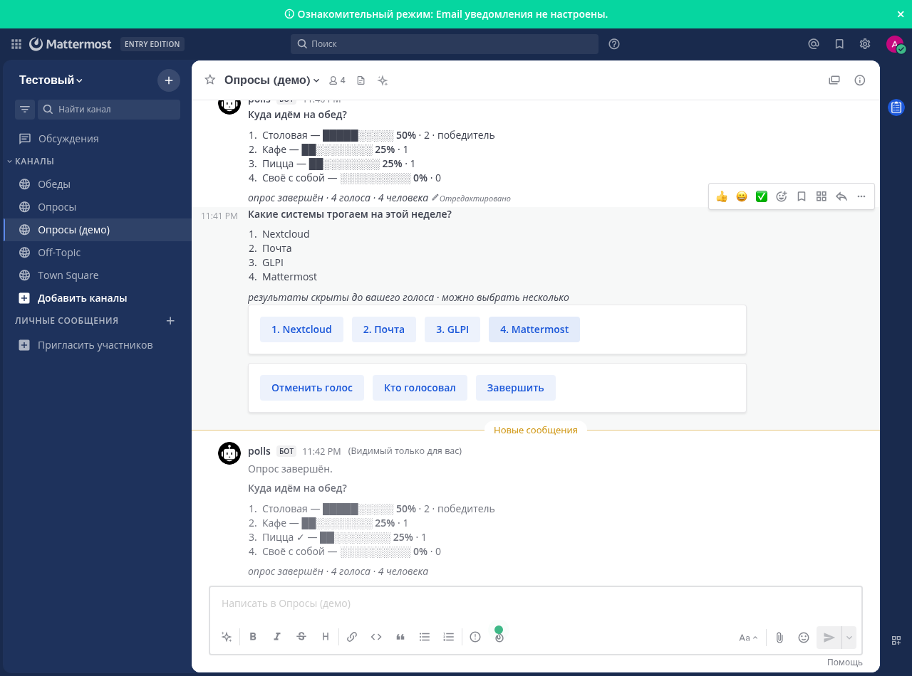

# Опросы для Mattermost

Плагин `com.chebcheg.plugin-polls` — голосования в стиле Телеграма: одно нажатие на вариант
под сообщением, результаты с полосками и процентами перерисовываются в том же сообщении.
Опрос создаётся командой `/poll` или кнопкой с диаграммой в панели форматирования над
полем ввода.

Зачем свой плагин, если есть Matterpoll: у Matterpoll в сообщении смешаны итоги, поимённый
список проголосовавших, кнопки «Add Option»/«Delete Poll»/«End Poll» и служебные подписи, а
настройки задаются флагами командной строки (`--progress --anonymous --votes=2`). Здесь в
сообщении только то, что нужно голосующему, параметры выбираются галочками в окне создания,
а «кто как голосовал» показывается по кнопке и только тому, кто нажал.



## Что умеет

- **Карточка опроса вместо простыни текста.** Сообщение с опросом рисуется как отдельная
  карточка: вопрос, подпись «Опрос», варианты с флажками. Пока человек не проголосовал, он
  видит бюллетень и строку «проголосуйте, чтобы увидеть результаты»; после голоса **та же
  карточка** превращается в результаты — проценты, полоски, счётчики и галочка на своём
  варианте. Состояние персональное: проголосовавшие видят итоги, остальные — бюллетень.
  В мультивыборе варианты отмечаются, затем кнопка «Голосовать».
- **Свой аватар бота.** Плагин рисует боту `polls` аватар — синий круг с белыми столбиками
  диаграммы, как у иконки плагина и кнопки в панели. Аватар ставится при запуске плагина,
  картинка генерируется кодом (никаких файлов в поставке не нужно).
- **Компактные кнопки.** Голосование — кнопки высотой 28 px (вместо штатных 36) и шрифтом
  13 px, отступы карточки поджаты; длинные варианты обрезаются по границе слова, полный
  текст — в подсказке. Стили привязаны к id конкретного сообщения с опросом, чужие кнопки
  в канале не затрагиваются.
- **Кнопка в панели форматирования.** Значок диаграммы в правом конце панели (рядом с
  приоритетом и «сгорающим» сообщением) открывает то же окно, что и команда. В мобильном
  приложении кнопки нет — там `/poll`.
- **Создание в окне** (`/poll`) — вопрос, варианты по одному в строке, три галочки:
  несколько ответов, анонимное голосование, скрывать результаты до голосования.
- **Быстрые формы командой**: `/poll Куда идём на обед?` (варианты «Да / Нет»),
  `/poll "Вопрос" "Вариант 1" "Вариант 2"`, флаги `--multiple`, `--anonymous`, `--hidden`.
- **Голосование в один клик** кнопкой под сообщением: в опросе с одним ответом голос
  заменяется, в опросе с несколькими — повторное нажатие снимает выбор.
- **Живые результаты**: полоска, процент и число голосов по каждому варианту, счётчик
  «N голосов · M человек», после завершения — отметка «победитель».
- **Личное подтверждение**: «Голос учтён: Кафе» с галочкой на своём варианте видит только
  нажавший. В опросе со скрытыми результатами там же показываются проценты — в канале они
  до голосования не видны никому.
- **«Кто голосовал»** — поимённый список по вариантам, тоже только нажавшему. В анонимных
  опросах кнопки нет.
- **«Завершить»** — автор опроса или администратор; `/poll end` делает то же из командной
  строки, если сообщение с опросом уже уехало вверх.
- Работает в браузере, десктопном клиенте и мобильном приложении: у плагина нет веб-части,
  всё держится на штатных кнопках и диалогах Mattermost.

| Окно создания | Кто голосовал | Завершённый опрос |
|---|---|---|
|  |  |  |

## Релиз

Готовый архив: **релиз v2.1.3** — https://github.com/chebcheg/mattermost-plugin-polls/releases/tag/v2.1.3
(артефакт лежит в реестре пакетов проекта, ссылка в описании релиза).

- `com.chebcheg.plugin-polls-2.1.3.tar.gz`, 6 992 255 байт
- sha256 `ca224497adf8812eb787c395e0daf6e7a3bfa3b17779d3895021075079319896`
- упаковка воспроизводимая: `make dist` из тега v2.1.3 даёт тот же архив байт в байт
- собрано коммитом `25b57ce42ae1a37c1848364c241956d04001c283`

## Установка

```bash
# на сервере Mattermost, из каталога с плагином
DRY_RUN=1 ./install.sh          # показать команды
DRY_RUN=0 ./install.sh          # установить/обновить и включить
```

Скрипт делает `mmctl --local plugin add --force <архив>` и `plugin enable`. Вручную то же
самое:

```bash
mmctl --local plugin add --force dist/com.chebcheg.plugin-polls-1.0.0.tar.gz
mmctl --local plugin enable com.chebcheg.plugin-polls
```

Или через **System Console → Plugins → Plugin Management → Upload Plugin**, затем включить.
При первом запуске плагин создаёт бота `polls` — от его имени публикуются опросы.

Проверка после установки:

```bash
curl -s https://<сервер>/api/v4/plugins/webapp | grep -o '"id":"com.chebcheg.plugin-polls"'
mmctl --local plugin list | grep polls
```

Обновление — тем же `install.sh` с новым архивом. Номер версии в `plugin.json` должен
отличаться: с тем же номером Mattermost откажется обновлять плагин.

## Настройки (System Console → Plugins → Опросы)

| Настройка | По умолчанию | Что делает |
|---|---|---|
| Анонимные опросы по умолчанию | выкл | галочка «Анонимное голосование» стоит сразу |
| Скрывать результаты до голосования | выкл | галочка «Скрывать результаты» стоит сразу |
| Сколько вариантов ответа разрешено | 12 | от 2 до 20, столько же кнопок в сообщении |
| Администратор может завершать чужие опросы | выкл | по умолчанию завершает только автор; включите, если админам нужно закрывать чужие опросы |
| Любой участник может завершить опрос | выкл | иначе только автор (и админ — см. предыдущую настройку) |
| Кнопка «Кто голосовал» | вкл | в анонимных опросах не показывается никогда |
| Как показывать имена проголосовавших | Фамилия Имя | варианты: «Фамилия Имя», «Фамилия И.», «Логин». При пустых полях профиля — псевдоним, затем логин |

## Ограничения и компромиссы

- **Список «кто голосовал»** раскрывается внутри карточки: вариант — отдельной строкой,
  ниже имена плашками, которые переносятся по строкам; до 30 человек на вариант (дальше
  «и ещё N»). Имена берутся из профиля — «Фамилия Имя» по умолчанию, есть варианты
  «Фамилия И.» и «Логин» (System Console → Plugins → Опросы). В мобильном то же
  самое приходит отдельным сообщением.
- **Карточку-компонент рисуют только браузер и десктопный клиент.** Мобильное приложение
  плагинные компоненты не запускает, поэтому там опрос показывается **карточкой-вложением**:
  акцентная полоса слева, строки вариантов с полосками и процентами, подпись со счётчиками и
  кнопки в той же карточке; вопрос вынесен заголовком сообщения. Персонального состояния
  там нет — карточка общая, проценты показываются по настройке опроса.
- **Опросы, созданные до 2.0.0**, остаются в текстовом виде: тип поста не меняется задним
  числом. Новые опросы сразу создаются карточкой.
- **Подписи кнопок-вложений без «N.».** Мобильный клиент рендерит текст кнопки как markdown,
  а строка вида `1. вариант` разбирается как нумерованный список — для списка у рендерера
  кнопки нет обработчика, и плашка остаётся пустой. Поэтому подпись собирается как
  `1 — вариант`. У опросов, созданных раньше, подписи исправятся после ближайшего
  обновления поста (голос или завершение).

- В общем сообщении канала нет отметки «я проголосовал именно так»: сообщение одно на всех,
  а личное состояние приходит отдельным сообщением, видимым только нажавшему. Это цена
  того, что плагин остаётся чисто серверным и одинаково работает на всех клиентах.
- После первого голоса сообщение несёт пометку «Отредактировано» — Mattermost ставит её на
  любое изменение поста, а результаты обновляются именно правкой сообщения.
- Кнопку «Завершить» видят все участники; не автору в ответ приходит «завершить опрос может
  только автор». Скрыть кнопку для части участников в одном сообщении нельзя.
- Голоса хранятся в KV-хранилище плагина (`poll_<id>`, индекс канала — `polls_<channel_id>`),
  изменения сериализуются мьютексом процесса. Для нескольких узлов Mattermost этого мало.
- Нет опросов «с правильным ответом» и добавления вариантов участниками.
- Если сообщение с опросом удалить, запись в KV остаётся — на голосование это уже не влияет,
  кнопки уходят вместе с сообщением.

## Сборка

```bash
cd webapp && npm install     # один раз: webpack 5 + babel
make test                    # go vet + go test (25 тестов)
make dist                    # серверная часть, веб-часть и архив dist/com.chebcheg.plugin-polls-<версия>.tar.gz
```

Сборка идёт с `CGO_ENABLED=0`: бинарник статический и не зависит от glibc сервера (иначе
плагин падает на «Unrecognized remote plugin message» при другом дистрибутиве).

## Проверено на живом стенде

Mattermost **12.0.2**, отдельная база PostgreSQL, четыре пользователя, браузер Chromium:

| Сценарий | Результат |
|---|---|
| `/poll` → окно → создание опроса | опрос публикуется, кнопки на месте |
| Голос кнопкой, смена голоса, отмена | счётчики и полоски перерисовываются в том же сообщении |
| Несколько ответов, повторное нажатие | выбор снимается, «Голос снят: …» |
| Скрытые результаты | до голосования в канале нет ни процентов, ни счётчика |
| «Кто голосовал» | список по вариантам, видит только нажавший |
| Анонимный опрос | кнопки «Кто голосовал» нет |
| «Завершить» не автором | «завершить опрос может только автор» |
| `/poll end`, `/poll help`, быстрый «Да/Нет» | работают |
| Мобильная ширина 390 px | кнопки переносятся, текст не обрезается |

`go vet` — чисто, `go test` — 25 тестов: логика голосования, права, подделка `user_id`
в теле запроса, разбор команды, валидация окна, отрисовка.

## Файлы

```
plugin.json                 манифест (id, версия, настройки)
server/                     Go: команда, кнопки, хранилище, отрисовка
webapp/                     веб-часть: кнопка в панели форматирования (webpack + babel)
server/poll_test.go         тесты (plugintest)
assets/icon.svg             иконка плагина
install.sh                  установка с DRY_RUN
images/                     скриншоты со стенда
```
